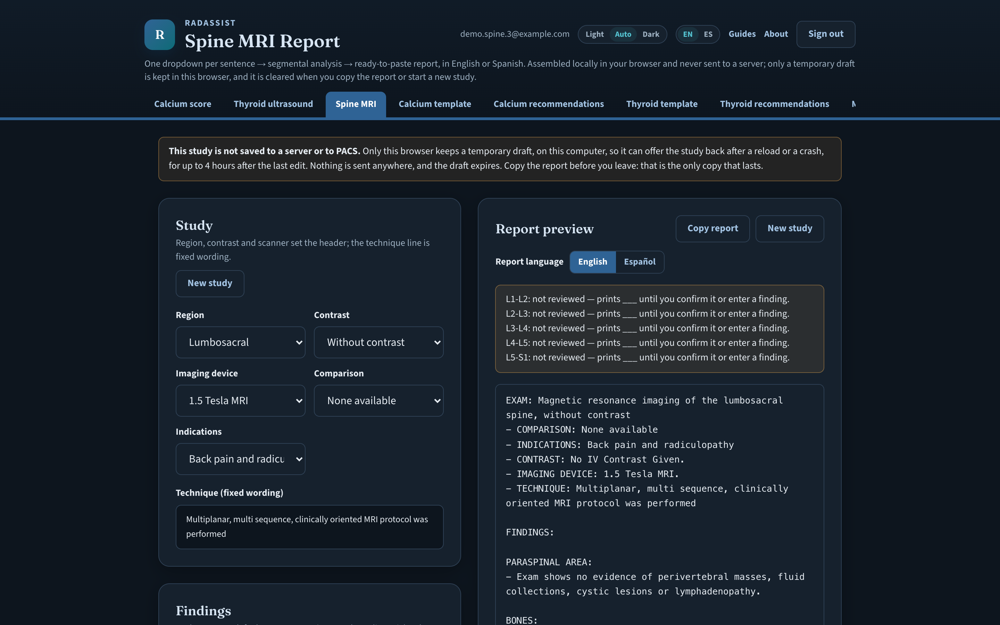
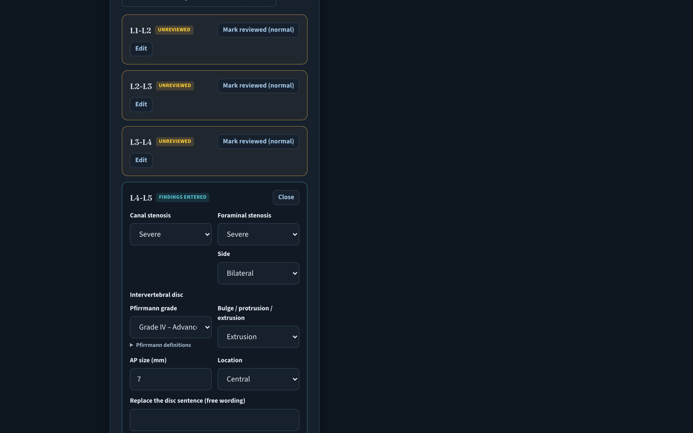
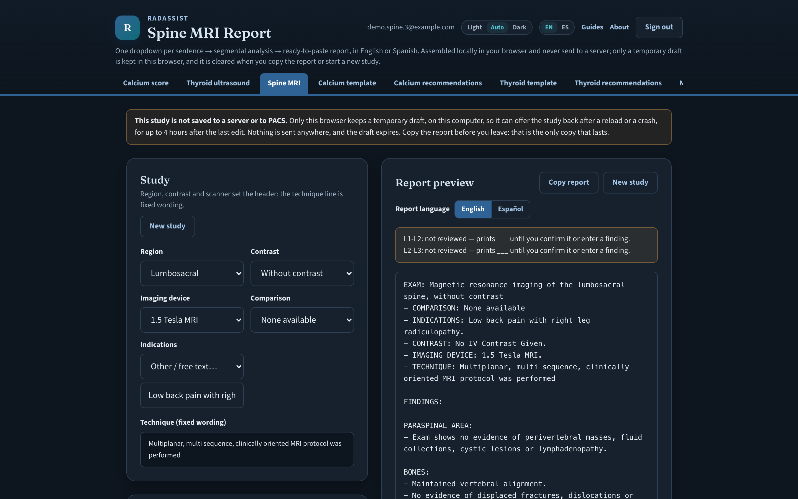
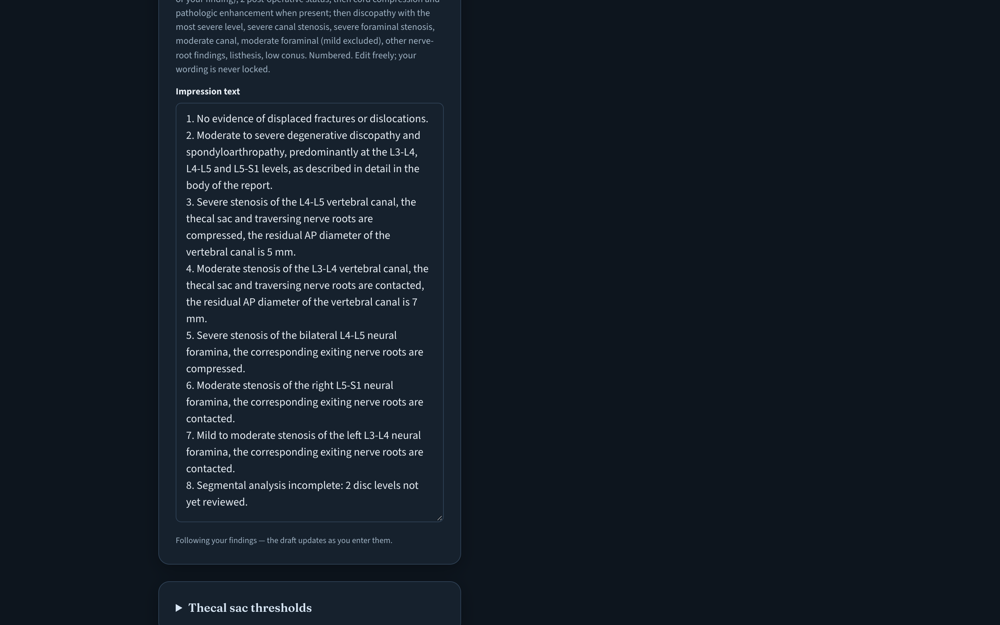
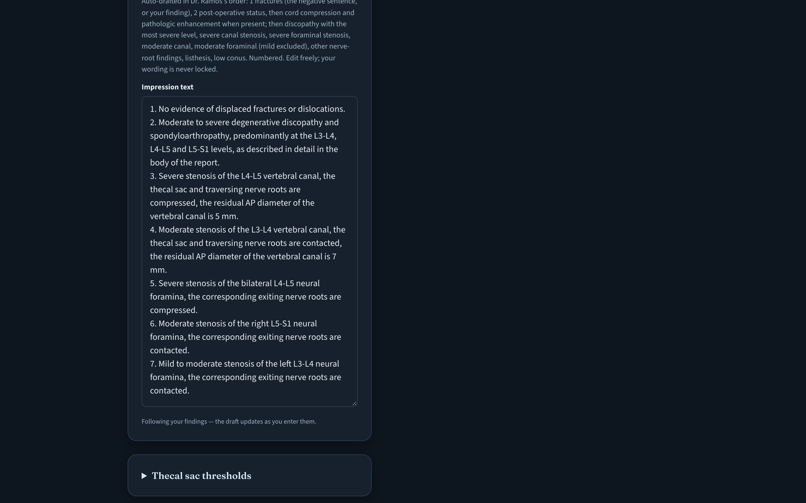
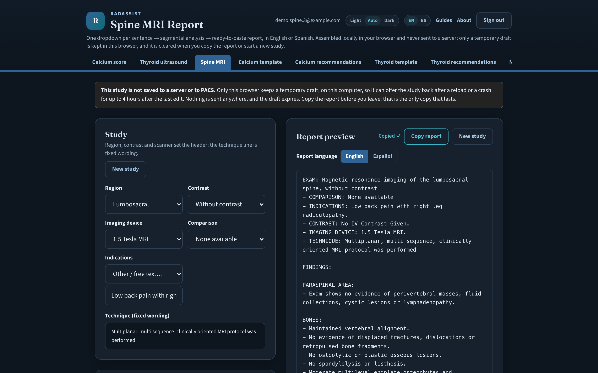
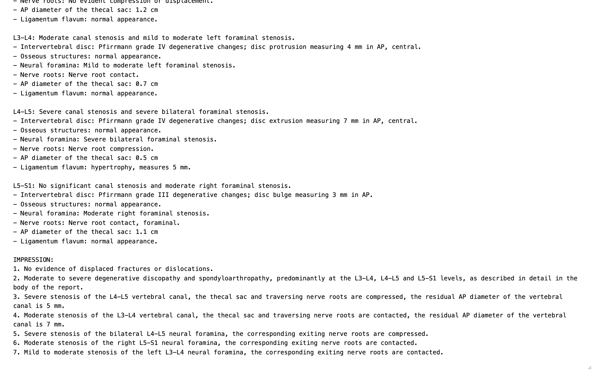

# Speaker Runbook: Imaging Center Automation Lunch

> ## 📌 UPDATED 2026-11-03, RICK'S ANSWERS TO THE 11-02 ROUND APPLIED. READ THIS FIRST.
>
> **Three changes 2026-11-03:** (1) **Slide 19 is a spoken RadAssist overview, no live demo** (Luis's feedback): one minute, then the table goes to Luis; no sign-in, hotspot test, case card or backups for it; the walkthrough stays in archive/DEMO-SCRIPT.md Part A marked not used; the prior authorization demo on slide 11 is unchanged. (2) **No license terms at the table.** You are selling a scope of work, a design for one imaging center that can be put anywhere; ownership of any product pieces is settled in the contract; no arrangement of Luis's is described anywhere; IF ASKED "who owns what?" is under the bus question. (3) **IF ASKED about a full-time role** is under "How much?". Slide clock re-timed: 19 is 29:00 to 30:00 and the freed minutes went to 22 through 27.
>
> **The meeting is LOCKED: LUNCH, Thursday 2026-11-05**, with Luis, Fernando Escarzaga and Jesse Martinez (moved from an evening the same week; see the 11-01 update below). Be ready Thursday morning.
> Rick's 11-02 review: transitions now sit on the previous slide as **LEAD-IN TO SLIDE N** blocks (speaking notes); slide 17 is an owner's user story; the spoken RadAssist line drops "live and tested the same day"; slide 20 states the deployment default (one environment under one contract, each organization in its own isolated instance with its own database, keys, credentials and audit log; fully separate stacks only for separately owned centers that want separate hosting, at higher cost; never one shared database); the HB 300 depth block under slide 22 now carries the statute's verified numbers (Sherlock, 2026-11-03); "perpetual license" and the lawyer comparison are out everywhere (and as of 11-03, all license-terms talk). **Lunch is about an hour: 40 minutes of slides, ten before, ten after; the skip order is under "The 40 minutes."**
> Rick has court by Zoom (final) on Wednesday 10-28. Attendees: **Luis, Fernando Escarzaga (spelling
> confirmed), and Jesse Martinez** (an engineer; quiet, analytic, humble). A quiet place and a
> conversation, not a pitch to an audience.
>
> **Deck is now 31 slides (27 no-numbers).** New: slide 6 (what an AI agent is), slide 11 (one order
> through prior auth, with the working demo, live at https://rfinlay.github.io/imaging-priorauth-demo/), slide 26 (what the dates
> depend on). The appendix is 28 (divider), 29 (the engagement: five phases, $45,000), 30 (the timeline,
> Nov to Jun, with payments and dependencies) and 31 (what I need from you). Every slide number in this runbook has been updated.
>
> **Timeline:** opening targeted around **June 2027, April at the earliest.** The **build starts ~March
> 2027** so prior authorization works before opening. Say "your new center" only: **no building,
> property, address, or prior business at the site, ever.**
>
> **Pricing, APPROVED by Rick 2026-11-02:** one fixed-fee engagement for the new center, **$45,000 in five
> phases, Nov 2026 to May 2027**: Discovery $7,000 ($4,000 at signing, $3,000 on delivery) · Vendor selection $8,000 ·
> Design and staffing plan $7,000 · Build and configure $14,000 ($7,000 Mar 1, $7,000 Apr 1) · Testing, training, go-live $9,000.
> Phases 2, 3 and 5 paid in full at the start; each phase starts only after the previous sign-off. Outside the phases: $150/hr,
> approved first, against a retainer they top up. Timeline flexes if the opening moves; the price does not. Red tags are gone. Answer under "How much?".
>
> **Fernando, per Luis:** straightforward, tough, tight with money; distrustful after vendors
> over-promised; visual ("When can I see it working?"). He will bring his own ideas. Give him the floor.
>
> **UPDATED 2026-11-01, after the 10-31 call with Luis.** The meeting moved to the week of 11-02 (now locked as
> lunch, Thursday 11-05; Luis picks you up for it, he is a neighbor). **Slide 19 was a live RadAssist Spine MRI demo from 11-01 to 11-03; it is now a spoken overview** (Luis's feedback). Spine shipped 10-31 from Luis's template, every rule his; say that, do not demo it. The case card and screenshots stay below as reference only.

**Date:** Thursday 2026-11-05, lunch, El Paso, Texas, private table (locked 2026-11-02)
**Audience:** Dr. Luis Ramos (champion, existing RadAssist user), **Jesse Martinez** (engineer; quiet, analytic), and **Fernando Escarzaga** (founded **Southwest X-Ray**, five El Paso centers, sold to Akumin 2019-08-16; the skeptic and the signer). **CONFIRMED by Rick 2026-10-01: Fernando Escarzaga is the partner, and Southwest X-Ray is his former company.** No longer an open question. He is an **RDMS sonographer and RPA**, clinical by origin, born 1956. **He did NOT found Desert Imaging** (that was Leroy Candelaria, a radiopharmacist) - never say he did. Co-owner **Veronica Escarzaga** was a named seller; do not assume he is the only decision-maker. Full profile: `~/OneDrive/Desktop/Luis-Partner-Profile-Sherlock-2026-10-01.md`.
**Speaking time:** 40 minutes of slides inside a lunch of about an hour (ten minutes before the first slide, ten after the last; the appendix, if asked for, sits in the last ten)
**Deck:** `imaging-center-automation-deck-2026-10-20.html` (31 slides: 27 of pitch and a four-slide appendix after the Thank You; presenter notes under each slide, press N).
**Leave-behind:** `imaging-center-automation-leavebehind-2026-10-20.html` (two pages; print one copy per person, three copies)

---

## Step 0: the confirmation text to Luis, send 2026-10-06 or 10-07

Approved 2026-10-01. Paste as-is. Three asks is the ceiling; a fourth reads like a questionnaire.

```
Luis - I did the brainstorming I promised. There's more here
than I expected, in a good way.

Let's do the week of October 20. I can work around whatever
evening suits you and your partner. Give me the day and I'll
be there.

I'll bring 40 minutes on four things he asked about:
scheduling and patient intake, answering patient calls,
medical records requests, and the throughput reporting an
owner actually wants. Plus one he didn't mention that I think
is the biggest one, which I'll save for the room.

Three things that would help me prepare. Roughly how many
studies a day and which modalities you're planning for year
one. How many people he's thinking of opening with on the
front end. And your partner's name, so I'm not meeting him
cold.

Looking forward to it. Thanks for putting this together.
```

**Why each ask is there.** *Studies per day and modalities* sizes the operation and is the volume number that has gone unanswered on the RadAssist side for two months; here there is finally a reason for Luis to answer it. *Front-office headcount* is the highest-value question in the text: a man who ran **34 people across five sites** and answers "three" is telling you he is building deliberately lean, which is exactly what you are selling. If he answers "eight," you are selling something different and you want to know before the room. *The name* sits last on purpose, so it reads as a throwaway logistics item rather than making the text about your prep gap.

**What is deliberately NOT in this text: anything about his history or the sale.** "How long did he stay on after the sale" is genuinely useful, but it is a question about the period he is **currently litigating**. Asking Luis invites Luis to repeat it, and *"Rick was asking about your Akumin years"* is a bad thing for Fernando to hear before you have met. Get it in the room instead, from the man himself, with the "two different ways" question in the ASK section below.

---

## Prep plan, Tuesday to Thursday (Rick-approved 2026-11-03)

Nine steps across three days. Each day's list is short on purpose; what is not on it waits.

**Tuesday 2026-11-03**

1. ==**Rehearse the prior authorization demo end to end**== (slide 11, https://rfinlay.github.io/imaging-priorauth-demo/). On the laptop and on the phone, both banner states. It needs no login. The standalone script for this run-through is `PRIORAUTH-DEMO-SCRIPT.md` (`PriorAuth-Demo-Script.pdf`).
2. **Mock Q&A, about 20 minutes.** Gio plays Fernando; the objection answers below are the script. Straightforward, tough, tight with money, visual.
3. **School is due tonight:** the 635 IR Plan and the 645 replies. Pitch prep stops when those start.

**Wednesday 2026-11-04**

4. ==**Review the updated slides with Luis, including the money aspects:**== the engagement is $45,000 in five phases, November to May, and outside work is $150/hr, approved first. His read on how Fernando hears the price is the point of the review.
5. **Gio applies ONE last update round from Luis's feedback,** renders every PDF and the Word copy, and syncs OneDrive and Drive. One round, then the documents freeze.
6. **Wednesday night, final read-through:** the highlighted lines in the speaking notes, the timing skip list under "The 40 minutes" (17, 25, 14, 10, 19 down to two sentences, 20; never drop 3, 4, 6, 11, 18, 19, 23, 24, 26), and the objection answers below.

**Thursday 2026-11-05, morning**

7. ==**Open the prior authorization demo on the phone (cellular) and on the laptop; confirm the banner.**== Leave both tabs up. ==**Text the link to Luis** (https://rfinlay.github.io/imaging-priorauth-demo/) so he can forward it to Fernando and Jesse; at the table they scan the QR on slide 11 or open the text, and everyone reloads once before the first click.==
8. **Print the leave-behind** (two US Letter pages from Chrome) if you want paper on the table. Three copies if so.
9. **Pocket card:** the five lines to land (Drill 1 in the speaking notes) plus the skip list. Luis picks you up. Lunch runs about an hour.

**Not before Thursday.** Luis's CT confirmation: it comes when it comes, do not push. The royalty and licensing conversation: private, with Luis only, after the lawyer's review; it is not in the room and not on the drive over.

**Already done.** Demo-steps email sent to Luis; he replied that the overview only is what he wants, and that is applied everywhere (slide 19 is spoken). The partner name is in (2026-10-06). The opening window is ~June 2027, April at the earliest (2026-10-22). The deck runs with no wifi; the demo is the only thing that needs a network. Leave the Sherlock research document at home; everything you need from it is in the deck notes and here.

---

## RadAssist on slide 19: spoken overview, NOT a demo (Luis, 2026-11-03)

**What you say, about one minute, from the slide:** what it is (structured radiology reporting, in production); Luis uses it every day on real patients; it runs on his own templates and his own rules, one dropdown per sentence, the impression in the order he set; it drafts and he signs; four modules (calcium scoring, thyroid ultrasound, spine MRI, CT spine); nothing leaves the browser, no patient data on a server, plain text into whatever system the center buys; it does not read an image, so it is not a device. Then: "Luis, tell him about a Tuesday." The full spoken block is under slide 19 in the SPEAKING NOTES.

**There is no pre-lunch setup for this slide.** No sign-in, no hotspot test for radassist.app, no case card, no plain-text window, no backup screenshots. If Fernando asks to see it, let Luis answer; it is his tool. The three-minute walkthrough is kept in archive/DEMO-SCRIPT.md Part A, marked not used Thursday.

**Reference only, in case Luis asks you to open it anyway.** The synthetic case below is what the walkthrough uses; it is not printed and not rehearsed for Thursday.

**The case card (synthetic; based on the guide's lumbar test case, simplified and de-identified):**

| Where | Field | Value |
|---|---|---|
| Study | Indications | Other, free text: `Low back pain with right leg radiculopathy` |
| **L4-L5** (the severe level) | Canal stenosis | Severe |
| | Foraminal stenosis, Side | Severe, Bilateral |
| | Pfirrmann grade | IV |
| | Bulge / protrusion / extrusion | Extrusion, AP size 7 mm, Location Central |
| | Nerve roots | Compression |
| | Ligamentum flavum | Hypertrophy, 5 mm |
| | AP diameter of the thecal sac (cm) | 0.5 |
| **L3-L4** | Canal stenosis | Moderate |
| | Foraminal stenosis, Side | Mild to moderate, Left |
| | Pfirrmann grade | IV |
| | Bulge / protrusion / extrusion | Protrusion, 4 mm, Central |
| | Nerve roots | Contact |
| | AP diameter (cm) | 0.7 |
| **L5-S1** | Foraminal stenosis, Side | Moderate, Right |
| | Pfirrmann grade | III |
| | Bulge / protrusion / extrusion | Bulge, 3 mm |
| | Nerve roots, Location | Contact, Foraminal |
| | AP diameter (cm) | 1.1 |
| Summaries | Conus | L1 |
| | Discs (summary) | Moderate to severe |
| | Bones | Endplate osteophytes Moderate; Modic Type II, levels `L4-L5` |
| Last | L1-L2 and L2-L3 | **Mark the remaining 2 levels reviewed (normal)**, then AP 1.2 at each |

**What the impression reads when the case is complete** (verified 2026-11-01 on the live build; this is the text Fernando will see):

1. No evidence of displaced fractures or dislocations.
2. Moderate to severe degenerative discopathy and spondyloarthropathy, predominantly at the L3-L4, L4-L5 and L5-S1 levels, as described in detail in the body of the report.
3. Severe stenosis of the L4-L5 vertebral canal, the thecal sac and traversing nerve roots are compressed, the residual AP diameter of the vertebral canal is 5 mm.
4. Moderate stenosis of the L3-L4 vertebral canal, the thecal sac and traversing nerve roots are contacted, the residual AP diameter of the vertebral canal is 7 mm.
5. Severe stenosis of the bilateral L4-L5 neural foramina, the corresponding exiting nerve roots are compressed.
6. Moderate stenosis of the right L5-S1 neural foramina, the corresponding exiting nerve roots are contacted.
7. Mild to moderate stenosis of the left L3-L4 neural foramina, the corresponding exiting nerve roots are contacted.

Before L1-L2 and L2-L3 are reviewed, an eighth line reads **"Segmental analysis incomplete: 2 disc levels not yet reviewed."** and those two levels print as blank lines in the body. That is the safety beat of the demo.

**Screenshots of the same case** (`demo-assets/`, reference only; not used Thursday):















The full-page report preview is `06-full-report-preview.png`, and the top of the pasted text is `08b-pasted-plain-text-top.png`.

---

## The 40 minutes

**The deck is 31 slides: 27 of pitch and a four-slide appendix.** Re-cut 2026-10-22 after the Luis
rehearsal: the agent explainer (6), the prior auth walkthrough with the demo (11), and the assumptions
slide (26) are new, and the engagement is now a design slide (29) and a separate build slide (30).

| Clock | Section | Slides | What happens |
|---|---|---|---|
**The hour (Rick, 2026-11-02: lunch is about one hour).** Ten minutes before the first slide: sit down, order, the cold-open card. Forty minutes of slides, 0:00 to 40:00 on the clock below and on every slide header. Ten minutes after: Fernando talking, questions, the appendix if the room asks for the number. If the food lands mid-deck, finish the slide you are on, eat, and resume; the clock pauses and the skip order does not change.

| Clock | Section | Slides | What happens |
|---|---|---|---|
| 0:00 to 5:00 | Open on timing, not technology | 1 to 3 | Greenfield framing. The four free contract terms. |
| 5:00 to 9:30 | The headline number | 4 to 5 | 11.5% appealed, 80.7% overturned. 40% with dedicated prior auth staff. |
| 9:30 to 11:00 | What an AI agent is | 6 | Two kinds, four guardrails, plain words. One line to Jesse. |
| 11:00 to 18:00 | The thing he did not ask about | 7 to 10 | Prior authorization: hours, the federal dates, the 4.94% denial rate. |
| 18:00 to 20:00 | One order, start to finish | 11 | The Tuesday walkthrough. The demo he will click. The Exa answer if it comes. |
| 20:00 to 27:00 | The three things he did ask about, corrected | 12 to 16 | Cancellations, reminders, voice, records. |
| 27:00 to 29:00 | Owner reporting and the scorecard | 17 to 18 | One breath. Slide 17 is the first to go. |
| 29:00 to 31:00 | Proof: RadAssist, spoken, then report assistance | 19 to 20 | One minute on RadAssist: what it is, Luis uses it daily, his templates and rules, it drafts and he signs, nothing leaves the browser, not a device. Then Luis describes a Tuesday. The roadmap line. No license talk, no demo. |
| 31:00 to 33:30 | Boundaries | 21 to 22 | FDA by statute. The compliance envelope, with the HB 300 numbers if asked. |
| 33:30 to 40:00 | **The close** | 23 to 27 | The bus question. What not to buy from me. If it were my money. What the dates depend on. Thank you. **The no-numbers deck ends here.** |
| 40:00 to 43:00 | **Appendix, only if the room asks** | 28 to 31 | Inside the last ten minutes of the lunch. The engagement, the timeline, what I need from you. Stop. |

**If short on time, skip, in this order.** You will not get all 40 minutes. Cut in this order and nothing you need is lost:

1. **Slide 17** (owner numbers): the scorecard on 18 already names it. Cut it if you are running long at 27:00.
2. **Slide 25** (if it were my money): keep its closing question and ask it on the Thank You.
3. **Slide 14** down to one sentence: "Your RIS will do reminders. Let it."
4. **Slide 10** down to one sentence: "A process that approves 95% of what it touches is one you automate."
5. **Slide 19** down to two sentences and Luis's Tuesday; **slide 20** to its heading and the one question.

**Never skip 3, 4, 6, 11, 18, 19, 23, 24 or 26** (the free move, four in five, what an agent is, the order walkthrough, the scorecard, the proof, the bus question, what not to buy from me, and what the dates depend on).

**Protect the close.** If you reach 34:00 and are still in the middle, stop wherever you are and
jump to slide 23. An unfinished middle costs you nothing. A missing close costs you the engagement.

---

## 🔴 LANDMINES: what must never be said to Fernando

Research established these. Each one is a real cost if you step on it.

1. **NEVER mention the Akumin lawsuit.** He is in **active federal litigation against the company that bought his business**: *Escarzaga v. Akumin Imaging Texas, LLC*, W.D. Texas, docket **3:25-cv-00291**, filed 2025-08-01, seeking over **$1,000,000** for age and disability discrimination and retaliation. He stayed on post-sale as Regional Director of Operations, watched Akumin go through Chapter 11, and was terminated without cause or severance. **Not obliquely, not sympathetically, not as "I understand it did not end well."** Revealing you know turns a business meeting into a question of how much you dug. If he raises it: listen, say little, ask nothing, move on.
2. **Never say he founded Desert Imaging.** That was **Leroy Candelaria**, a radiopharmacist. Different man, different company. Telling him otherwise says you confused him with a competitor.
3. **Never say "scale," "platform," "roll-up," or "synergies."** And never **"density in key markets"** - that is near-verbatim from the Akumin press release announcing the purchase of his company. These words describe the period of his life he is currently suing over.
4. **Never say "when you sold to private equity."** He sold to a **publicly traded** company (TSX/NASDAQ: AKU). Private equity arrived later, through bankruptcy.
5. **Never cite Akumin or Stonepeak as a reference customer, a model, or an example of innovation.**
6. **Never frame automation as headcount reduction.** He came up as a technologist and has run departments. He knows the people who answer those phones. If he thinks you are selling layoffs he will disengage politely and you will never know why.
7. **Do not assert his founding year.** Sources say 2003, 2004, and 2006. Let him say it.
8. **Do not mention his age** (born 1956).
9. **Call him Fernando, never Jesus.** Legal first name is Jesus, middle name Fernando; every business-facing source uses Fernando. **Spell it Escarzaga** - Akumin's own release misspelled it "Escargaza" and the BBB says "Escarcega." Both wrong.
10. **Do not treat him as the only decision-maker.** **Veronica Escarzaga** was a named co-seller and the company held woman-owned designation. Do not discover her at the table.

## The reframe that follows from all of this

**He is not looking for a platform to scale. He is reclaiming operational control.** At 69, having already run a 34-person five-site company and watched the buyer unravel it, he is building lean on purpose.

So **lead with "run this center with a lean front office," never "grow."** He does not want a bigger org chart; he wants the work done without one. That is the strongest honest case for agents that exists, and it is probably why Luis says he has a lot of interest.

And **volunteer your exit terms before he asks.** He has lived the consequences of a signed agreement whose counterparty stopped behaving as expected, so your assurances carry less weight with him than with almost any buyer you will meet. Compensate with verifiable structure, not warmth. Slide 24 is now the most important slide in the deck, not the third most.

---

## The five headline numbers, exact wording, with the caveat you must say

### 1. 11.5% appealed, 80.7% overturned (slide 4)

**Say:** "In 2024, Medicare Advantage insurers denied 4.1 million prior authorization requests. Only 11.5% of those denials were appealed. Of the appeals that were filed, 80.7% were partially or fully overturned. Four in five appeals win. Almost nobody files one."

**Then say, before anyone asks:** "That is Medicare Advantage, all services. It is not an imaging number, because CMS does not collect prior authorization data by type of service. It is the only audited, payer-reported, national figure that exists, and it describes the system your center bills into."

Source: KFF, 2026-01-28, analysis of data insurers report to CMS. 4.1 million denials were 7.7% of 52.8 million determinations.

**What it is not:** a labor-savings number. It is an abandoned-revenue number. The binding constraint it reveals is staff capacity and follow-through.

### 2. 40% have staff working exclusively on prior auth; 13 hours per week (slides 5 and 8)

**Say:** "Physicians and their staff spend an average of 13 hours a week on prior authorization, about 40 requests per physician per week. Forty percent of physicians report having staff who work exclusively on it. You have not hired that person yet."

**Then say:** "That is the AMA's 2025 survey of a thousand physicians. It is self-reported."

Supporting figures if pressed, same survey: 32% say prior auths are often or always denied; 74% say denials increased over five years; of those who do not appeal, 59% do not expect to win and 52% cite insufficient staff time.

**Do not** turn this into a headcount-reduction pitch. El Paso wages run roughly 25% below the national average across all occupations (BLS, El Paso MSA mean hourly $24.94 versus $33.54 nationally). A displaced-FTE argument is worth less here than it sounds. Lead with revenue capture and capacity.

### 3. CMS's 220 million hours (now one line on slide 8, no longer its own slide)

**Say:** "In its 2024 prior authorization rule, CMS estimated the rule would save providers at least 220 million hours and 16 billion dollars over ten years. They based that on AMA data showing 14 hours per physician per week."

**Then say:** "That is CMS's projection in the rule. It is not measured savings. Nobody has gone back and counted yet."

Source: CMS-0057-F, 89 FR 8758, published 2024-02-08, Regulatory Impact Analysis.

Note the two AMA figures are different years: 13 hours is the 2025 survey, 14 hours is what CMS cited in the 2024 rule. If someone notices, say exactly that.

### 4. 5.1% to 3.8% (slide 14)

**Say:** "A randomized trial at Massachusetts General, about seven thousand MRI patients, added a text reminder on top of the phone call they were already making. No-shows went from 5.1% to 3.8%. It did not improve arrival punctuality."

**Then say:** "That is 1.3 percentage points absolute. Vendors will tell you that is a 25% reduction. Same study. And only about two thirds of the texting group could actually be reached by text. Your RIS will do this. Let it."

Source: Liu et al., J Am Coll Radiol 2017, PMID 28583321. n=6,989, p=0.02, odds ratio 0.75. Only 67.5% of the texting arm reachable by text.

### 5. 22.3% cancelled versus 2.0% no-show (slide 13)

**Say:** "A University of California, Irvine study of about nineteen thousand outpatient radiology exams found 22.3% were cancelled and 2.0% were no-shows. Seventy percent of the cancellations were patient-initiated. Most empty slots are known in advance. That is a backfill problem, not a reminder problem."

**Then say:** "That is one academic center over 2022 and early 2023. Your numbers will differ. The pattern will not: cancellations outnumber no-shows many times over, and most of them come with notice."

Source: Aijaz et al., Acad Radiol 2024, PMID 38705764. 19,262 exams, 9,713 patients. 70.19% patient-initiated.

Pocket figure for the scheduling conversation: across 2.9 million outpatient imaging visits over 16 years, booking more than six months out carried an odds ratio of 3.18 for no-show versus booking within a week (Rosenbaum et al., J Am Coll Radiol 2018, PMID 29755001). Shortening time-to-appointment reduces no-shows on its own, and backfill is how you shorten it.

---

## Other numbers on slides, with their framing

| Number | Slide | Source | Caveat |
|---|---|---|---|
| 4.94% of 17,913 outpatient MRI prior auths denied | 10 | Harrer et al., J Am Acad Orthop Surg 2025, PMID 39729599 | One institution, 2019 to 2022. The point is that 95% get approved, so the labor goes into a process that nearly always says yes. |
| 7 calendar days / 72 hours decision timeframes, 2026-01-01; FHIR Prior Authorization API, 2027-01-01 | 9 | CMS-0057-F rule text | Binds payers, not providers. Covers Medicare Advantage, Medicaid and CHIP, and exchange plans. Does not reach employer-sponsored plans, TRICARE, or VA. The slide now says so; say it out loud before anyone asks. |
| Almost 63% of medical plans building a FHIR prior auth API | 9 | 2025 CAQH Index (DataSpring), 2026-02-19 | Payer self-report. |
| 26.5% of El Paso County residents speak English less than "very well"; 97.8% of them Spanish speakers | 14 | ACS 2024 5-year, Table B16004 | Computed from raw counts. Say 26.5%, not the 66% who speak Spanish at home. The operational number is the limited-English number. |
| 30-day clock, one 30-day extension, 60-day outer limit | 15 | 45 CFR 164.524 | Texas is shorter: 15 business days from a written request for an electronic record (Health and Safety Code 181.102, verified 2026-11-03). Say both. |
| HB 300: training within 90 days of hire, signed statement kept 6 years, retraining only after a material change in law; penalties up to $5k negligent, $25k knowing, $250k for financial gain, $1.5M a year for a pattern; $250k yearly cap if encrypted or policies and training in place; posting duty since 2025-09-01 (HB 4224) | 22 | Tex. Health and Safety Code 181.101, 181.102, 181.105, 181.201; Texas Legislative Council text, verified by Sherlock 2026-11-03 | Never say "every two years"; the 2011 refresher was removed in 2013. The posting duty is the center's. |
| $6.50 flat fee survived Ciox | 15 | Ciox Health v. Azar, 435 F. Supp. 3d 30 (D.D.C. 2020) | The court never reached the merits on the fee methods; the option remains. |
| More than 50 OCR Right of Access enforcement actions | 15 | OCR | "More than 50" is supportable. Do not quote a settlement figure. |
| TCPA: one message per day, three per week; $500 per violation, up to $1,500 if willful | 20 | 47 CFR 64.1200(a)(9)(iv); 47 U.S.C. 227 | $1,500 is the treble ceiling, not a fixed amount. |
| Texas SB 1188 US-only storage effective 2026-01-01 | 20 | Bill history at capitol.texas.gov; provision wording from law-firm analyses | Say "as I read it" if pressed on exact wording. |

---

## Numbers you must NOT say, even if asked directly

The research could not verify these. If Fernando quotes one of them to you, do not confirm it. Say "I have seen that number and I could not trace it to a source I trust, so I will not use it."

- Any CAQH per-transaction cost (the "$15 manual versus $6 electronic" or "$11 versus $1.50" figures). The chartbook is paywalled and the circulating numbers contradict each other.
- Administrative labor as a percentage of imaging center operating cost. Ask him for his instead.
- Imaging prior authorization denial rates of 25 to 40%. Vendor-blog numbers that contradict the peer-reviewed 4.94% and the KFF 7.7%.
- Any percentage of advanced imaging that requires prior authorization. "Most commercial and Medicare Advantage plans require it for CT, MRI, and PET" is fine as a sentence. A number is not.
- Any vendor's price, for RIS, voice, or prior auth tools. Nobody publishes list prices.
- HL7 interface fee ranges. "Customary, per interface, and negotiable before signature" is the whole statement.
- "HB 300 training every two years." The refresher interval was removed from the statute in 2013; retraining is required only after a material change in the law. The verified HB 300 numbers (90 days, 6 years, 15 business days, the penalty tiers) are in the table above and under slide 22 in the speaking notes; those you may say.
- Cost or time per prior authorization, call abandonment rates, days in A/R, phone volume per study, time-to-schedule benchmarks. None of these exist in defensible form.
- Records retrieval cost per request.
- A count of independent imaging centers in the US or Texas.

**Added 2026-10-12 from the El Paso payer-mix research.** These are false or unverified. Each one has a replacement that is primary-source confirmed.

- **Never "VA requires precertification."** False since 2026-09-08. VA eliminated precertification entirely and took the precertification portal offline. Say instead: "VA dropped precertification in September 2026; the referral and the SEOC govern."
- **Never "TRICARE requires prior auth for MRI, CT, or PET."** For TRICARE Select, For Life, Reserve Select, Retired Reserve, and Young Adult-Select, advanced imaging needs no referral and no pre-authorization; imaging is not on the pre-auth list at all. Only Prime involves a referral. Use the plan-by-plan language in the Fort Bliss objection below.
- **No percentage of the center's imaging VOLUME by payer channel.** The Census measures coverage of residents, not utilization, and imaging skews older and sicker. No defensible conversion exists. Give the coverage shares, then hand the conversion to Fernando: "Volume will skew older than coverage does; you would know the conversion better than I would."
- **Never "185,499 military retirees live in El Paso."** The Texas Comptroller counts retirees with installation access, a catchment wider than the county. Say "with Fort Bliss installation access."
- **No commercial multiple of Medicare for a freestanding imaging center.** The published RAND multiple is for hospital inpatient and outpatient combined; ambulatory surgery centers come in well below it. A freestanding center sits in the lower band, and his actual number is whatever he negotiates. No multiple is on any slide; keep it that way.
- **No VA referral expiry in days.** The regulation caps an episode of care at one calendar year (38 CFR 17.4005). Specific SEOC windows are not primary-source verified. Say: "A VA episode of care is capped at one calendar year by regulation, and the specific SEOC sets the scope. The expiry discipline is what protects the claim."
- **Never "CMS-0057-F requires providers to use the FHIR APIs."** It obligates payers to build and maintain them. Say: "The rule makes the payers build the APIs. Whether you can use them depends on your software vendor, which is exactly the integration question."
- **Never "VA or TRICARE have a FHIR prior-auth API you can integrate with."** Verified false by live probe on 2026-10-12. VA's production FHIR API exposes 19 resources, none of them authorization or referral. Those channels stay referral-and-SEOC workflow, not API.

The CAQH figures that ARE safe: $258 billion in administrative cost avoided in 2024 through electronic transactions, and a $21 billion remaining annual savings opportunity. Both from the 2025 CAQH Index, 2026-02-19. They are not on a slide; use them only if the conversation goes there.

---

## Anticipated objections and your answers

### "Doesn't our RIS already do this?"

"For scheduling, reminders, self-scheduling, and intake forms: yes, and it should. I am telling you to buy that and use it. RamSoft's imaging-center product, for one, advertises self-scheduling, automated notifications, and a workflow designer. What I have not seen any RIS in this tier claim is eligibility verification or prior authorization. That gap is where the strongest evidence is, and it is the piece you did not ask about."

Hold the line: do not claim the RIS definitely lacks a prior auth module. Say you have not seen it advertised, and that the specification will verify it against whichever RIS they pick.

### "What does Phase 2 actually produce on the vendor side?"

"The interface list. Every interface the automation plan needs, whether each one runs over HL7 version 2 or an API, which direction the data moves, and what the vendor charges for it. In writing, before you sign."

Interface complexity is a Phase 2 deliverable (vendor and system selection), not an assumption. The contract term (count and fee schedule fixed at signature) protects him from the price. It does not tell him whether he asked for the right interfaces. That is the work.

### "Be specific. What does 'API access to your own data' mean?"

Four things, and name them in the contract rather than the word "access": read access to the clinical and scheduling data the center owns; bulk export on demand; the audit and error logs, because you cannot operate what you cannot see fail; and a test or sandbox environment, so changes are not proven in production.

On Rick's own build this answers itself: the center-specific code, its logs, and its database live in a repository and environment under the center's organization.

### "What happens when you get hit by a bus?"

Slide 23. Say it in this order:

1. "You own the specification. It is the deliverable of the design engagement whether or not I build anything, and it is written for a competent engineer who has never met me."
2. "You own the code. It lives in a repository under your organization's account. You can revoke my access." Then, raised by you and not found by him in a redline: "One distinction. What I am selling you is a scope of work: a design for one imaging center, built so it can be put anywhere. Everything specific to this center is yours outright, in your repository, and so are your configuration and your data. Some of what I would build is existing product of mine that I would extend for you. Who owns which pieces is settled in the contract, not at this table, and you keep running all of it either way. You are never hostage to me." No license terms at the table (Rick, 2026-11-03), and nothing about any arrangement of Luis's.
3. "Runbooks, not memory. Every operational procedure is written down: how it runs, how it fails, who to call at each vendor."
4. "No proprietary runtime. Standard interfaces, HL7 v2, DICOM, payer APIs, and a named model vendor under its own business associate agreement. Any integrator can take it over."
5. "The RIS and the voice vendor are contracted in your name. Nothing routes through me that does not have to."

The three tiers, if he asks what exactly is his: the specification, theirs outright. Everything specific to this center (configuration, workflows, integrations, data mappings, reports), theirs outright, in their repository, your access revocable. Existing product of yours that you extend for them (the prior auth engine, the backfill engine, the reporting core), yours, and how the center uses it is written into the contract. Say no more than that.

### "Who owns what?" (IF ASKED; Rick, 2026-11-03)

"The contract settles it. The center owns its configuration and its data, and everything built specifically for this center. Where existing product of mine is part of the build, the contract says how you use it. We write that together, and you see it before you sign anything." If pressed: "Not at lunch. That is a contract conversation, and I would rather get it right on paper than guess at it here." No license terms, no arrangement of Luis's, nothing about resale.

If he asks why the product pieces are not simply his: "Keeping my own product mine is part of what keeps the price where it is. If you want a different arrangement, that is a contract conversation, and I am open to it."

If he asks about source code escrow: "Direct ownership is better than escrow. The code for your center is in your repository, so there is nothing to escrow. Whatever of mine the center runs is covered in the contract, which is the thing escrow is supposed to give you after a fight. You have it on day one, without the fight."

If he asks about a second person: "There is no second person. That is the honest answer, and it is why the engagement is structured so that the specification and the runbooks are the continuity plan, not me."

### "How much?"

**Say exactly this, once, then stop talking:**

> "One engagement for the new center. Forty-five thousand, fixed fee, fixed scope, in five phases from now to May. Discovery, seven. Vendor selection, eight. Design and the staffing plan, seven. The build, fourteen. Testing, training and go-live, nine. Each phase ends in a document you sign, and the next one does not start until you have."

**Then the payment line:**

> "Four thousand when we sign and three when you have the requirements. After that each phase is paid when it starts, except the build, which is seven on the first of March and seven on the first of April."

**The five phases (slide 29):**

| # | Phase | When | Deliverable | Fee | Paid |
|---|---|---|---|---|---|
| 1 | Discovery and requirements | Nov to mid-Dec 2026 | Requirements and Roadmap | $7,000 | $4,000 at signing, $3,000 on delivery |
| 2 | Vendor and system selection | Mid-Dec to Jan 2027 | Vendor Selection Report, contracts to sign | $8,000 | In full at the start |
| 3 | Design and staffing plan | Feb 2027 | Architecture, Workflow and Staffing Plan | $7,000 | In full at the start |
| 4 | Build and configure | Mar to Apr 2027 | All systems working in test | $14,000 | $7,000 Mar 1, $7,000 Apr 1 |
| 5 | Testing, training and go-live | May 2027 | Signed go-live readiness, opening-week support | $9,000 | In full at the start |
| | Total, ready for a ~June 2027 opening with about a month of buffer | | | **$45,000** | |

**"Why do we pay at the start of each phase?"** "Because you have already signed off the phase before it. You are never paying for something you have not seen; you are paying for the next piece after you approved the last one." The largest single check is nine thousand. Do not compare it to how their lawyer bills (Rick, 2026-11-02).

**"What if the opening slips?"** "The timeline moves with it and the price does not. The phases are the work; the dates are where the work lands."

**"What does the $150 an hour cover?"** "Only things you ask for outside the five phases. You approve each one first, and it draws against a retainer you top up. If you never ask, you never pay it." Nothing inside the five phases is billed by the hour.

**"How do you make money?"** (Luis already asked): "One fixed fee, in writing, for taking the new center from requirements to opening day. Anything outside it is approved first and billed by the hour."

**Do not** break out hours for the phases, name what forty-five works out to per hour, or justify the number at length.

**If he pushes on price: shorten the term, never cut the rate.** "Take Phase 1. Seven thousand, six weeks, and you own the requirements whether or not we go on."

**"Does that change at three centers?"** "No. Requirements, vendor selection, and design are done once for this center. A second center is its own, smaller engagement, mostly build and go-live."

**"What about keeping it running after opening?"** Opening week is inside Phase 5. After that, the $150 retainer, or a support agreement scoped in writing once there is real volume. Do not quote a monthly fee today; nothing has been priced.

**Contract through RGF Global Ventures LLC, never personally.** Do not discount because Luis is a family friend; RadAssist is not inside this fee.

### "Would you come in full time?" (IF ASKED; Rick, 2026-11-03)

They may float a salaried, dedicated role. Say exactly this, and no numbers: "I'd want to hear it. Let's finish Phase 1 first; that's the job to judge me on. If it makes sense after that, we can talk about what a dedicated role looks like." No salary, no title, no start date, nothing about what else you would give up. If pressed: "Phase 1 is six weeks. Judge me on it, then we talk." Then back to the phases.

### "We want something of yours live before a specific date" ⚠️ the one you are most likely to get

**Updated 2026-11-02: the engagement now runs to opening day. Phase 4 (March to April) builds and configures every system, and Phase 5 (May) tests, trains and signs go-live readiness, with about a month of buffer before a June opening. Every date on it is conditional on the slide 26 assumptions.** Outside that frame, the 2026-10-10 rule stands: **do not promise anything of yours live by a date you do not control.** Anything of Rick's that runs needs a host, a database, an LLM API bill that scales with use, auth, backups, and monitoring. That is a recurring line in *their* operating budget, forever, and it is estimated in writing in Phase 3 before they own it.

**The position is neutral, not defensive.** Do not explain why nothing of yours is live yet and do not apologize for it. Convert the push into a scoping question:

> "What has to be live the day you open is your vendors' work: the RIS, billing eligibility, the HL7 interfaces. Phase 2 is where I make sure their contracts actually deliver it, and Phase 4 is where it all gets connected and proven in test. If you want a specific piece live by a specific date, tell me which piece and we will scope it against the timeline."

**The last sentence is the whole move.** Not a no, not a yes-with-a-date.

**Know the cost of this position before you walk in, so it is not a surprise at the table.** You have no day-one deliverable of your own. If Fernando asks "what do I have on opening day," the honest answer is a contracted vendor stack that works plus a set of priced specifications. For a man who has lived through a bad implementation, absence-of-surprises is a real product. But hear that sentence out loud now rather than discovering it mid-lunch.

### "Should we hire for prior auth, or will your automation cover it?" ⚠️ the delicate one

**Rick's own concern, 2026-10-10, and it outranks every scheduling question in this runbook.** Every other question is about Rick's delivery date. This one is about **their irreversible decision.** A center that opens with six front-office FTEs because the automation was not ready has made a hiring commitment that automation later converts into layoffs, in El Paso, in a small market, with Fernando's name on it and Luis practicing locally. Layoffs at a six-month-old imaging center is a story that follows both of them. It cuts the other way too: a center that *under*-hires against a promise that slips has a front office that cannot answer the phone during the exact window that forms its referral reputation. Both failure modes cost more than being wrong about a build date.

**Volunteer this. Do not wait to be asked.** Saying "I'm not going to tell you to hire thin on my promise" to a man who has run five centers and been through a PE exit is the most credible thing available at that table. Same mechanism as the data-quality caveat: naming the limit of your own pitch is what makes the rest believable. Fernando specifically will hear it, because he is the one who would have to do the firing.

> "Staff for the manual workflow at opening. That is the only thing either of us can verify on day one, and I am not going to tell you to hire thin against a date of mine. What I will give you in Phase 1 is the sequence: which roles change as each piece goes in, and in what order, so each one is a decision you make later rather than a commitment you make now. Planned, attrition and role changes absorb most of it. Discovered, it becomes a layoff."

**FRAMING, NON-NEGOTIABLE.** Never say automation **reduces headcount.** Always say automation **changes what your people do.** For a greenfield center scaling from zero that is also the *truer* claim: no existing job is eliminated, they are avoiding hires otherwise needed around month eighteen. Growth absorption, not reduction. Same economics, no layoff implication, and accurate.

**The staffing plan is a named Phase 3 deliverable: "Architecture, Workflow and Staffing Plan" (slide 29).** Hire for the manual workflow at opening, then the sequence in which each role's work changes as each piece goes in, each piece an explicit later decision. This is program-management work no vendor will ever produce. On the slide and in your mouth it is "how each role's work runs with the automation in place," never a headcount target.

### "Didn't a bunch of AI healthcare companies already die doing this?"

"Yes. Olive AI raised an enormous amount of money, shut down in 2023, and sold its prior authorization assets to Waystar and Humata Health. It sold broad automation to hospital systems on long implementation cycles. That is close to the opposite of one person building a narrow agent for one site he can watch directly."

### "Why should we not just buy a prior auth vendor?"

"The category exists: Availity, Waystar, Cohere Health, Humata Health, Infinitus. It is priced and implemented for health systems and large groups, and a lot of it is payer-funded. At your size, whether that is one center or three, you are the customer they take last and configure least. And the appeal gap in the KFF data is not a technology gap. Nobody has time to file the appeal. That is a workflow problem that a narrow agent and a human sign-off step fix, and a vendor built for a hospital system does not."

### "This rule doesn't cover most of my commercial book." ⚠️ the one that breaks the regulatory claim if you let it

He is right, and you say so first. CMS-0057-F binds Medicare Advantage, Medicaid, CHIP and exchange plans. It does not reach employer-sponsored commercial plans; CMS was asked directly about the people in employer coverage and declined for lack of authority. In El Paso County, employer-based-only coverage is 268,142 people, 31.8% of the insured universe, seven times the two military channels combined (38,832, 4.6%). So the rule does not automate prior auth for the largest block of the commercial book, which is where the margin is.

Say: "Correct. The rule reaches Medicare Advantage, Medicaid, CHIP and the exchange plans. It does not reach your employer-sponsored commercial plans, and that is the largest single block of coverage in this county. I am not selling you a compliance deadline. I am pointing out that the payers who move first set the standard the rest follow, and your build window lands exactly on that transition. The burden is real on every payer, the margin is in commercial, and the process fix pays for itself whether or not a given plan is on the API."

The demotion is deliberate. CMS-0057-F is the reason the window is now, not the reason to do this. For commercial plans outside the rule, the design falls back to EDI 278 where supported, and otherwise a complete packet prepared for a human to submit. That was always the design; this objection just makes you say it earlier.

### "Most of our volume will be Fort Bliss and the VA." Or: "What about TRICARE?"

Source for every number here: ACS 2024 5-year, table B27010, El Paso County. Coverage of residents, not imaging volume.

Say: "I looked that up, because you would know better than I would. In El Paso County, TRICARE-only and VA-only coverage together are under five percent of the insured population, about thirty-nine thousand people out of eight hundred forty-four thousand. Commercial and Medicare are where the volume and the margin are. The military channels matter for front-office workflow, not for the business case."

The exact figures if he wants them: TRICARE-or-military-only 33,795 (4.0%), VA-only 5,037 (0.6%), combined 4.6% of the 844,384 insured universe. Employer-based plus direct-purchase 320,020 (37.9%). Do not convert any of these to a share of his studies; hand him that: "Volume will skew older than coverage does. You would know the conversion better than I would."

The non-obvious number that matters more to a greenfield pro forma than either military channel: El Paso County's uninsured rate is 21.6%, about 183,000 people. Self-pay policy and point-of-service collection are the real operational factor, and they are a front-desk scripting and workflow problem that the intake design has to own.

If he goes plan by plan on TRICARE: "El Paso is TRICARE West, and TriWest has been the West Region contractor since January 1, 2025. For TRICARE Select and TRICARE For Life, MRI, CT and PET need no referral and no pre-authorization. For Prime, non-active-duty, specialty care and some diagnostic services need a PCM referral, and the regional contractor issues the referral and pre-authorization together. For active duty on Prime, it is a referral for anything the PCM does not provide, plus pre-authorization for all specialty care. If a Prime enrollee self-refers, they are on the point-of-service option and their out-of-pocket goes up. That becomes a front-desk conversation, which is a staffing and scripting problem, not a payer problem."

If he goes to VA: "VA community care is referral-and-authorization driven, not an approve-deny gate like commercial prior auth. Texas is Community Care Network Region 4 and TriWest is the administrator. VA pays community providers at the Medicare rate unless there is a contract rate; that is 38 CFR 17.4035. VA reimburses only for services explicitly authorized in the referral, so anything outside the SEOC scope needs a Request for Service approved before you deliver the care, and VA processes one in three business days. As of September 8, 2026, VA no longer requires precertification and the precertification portal is offline. The referral and the SEOC are what govern now." Never say "VA requires precertification." Never give a referral expiry in days; the regulation caps an episode of care at one calendar year.

Neither channel is reachable by the FHIR API story, and you say that before he does: "TRICARE is not mentioned once in the final rule. On VA and DoD, CMS wrote that these are independent agencies over which HHS has no authority. Those two stay referral-and-SEOC workflow, which is intake and tracking discipline, not an API."

### "We are opening three centers." Or: "Does any of this change at three?"

"Three makes the design work more valuable, not less. The specification gets written once and deployed three times, and the four contract terms get negotiated once across all three. Three centers is a reason to buy the specification, not a reason not to." Do not assume a count. Use the number he gave you at the open; if he did not give one, ask. The price line does not change.

### "Is this one system for all three centers?" Or: "Why not one shared setup?"

Slide 20, last block, and only if more than one center comes up. "One specification, written once and reused for every center. The way I would deploy it is the industry standard, and it is security first. One environment, under one contract, which is what keeps the cost down. Inside it, each organization gets its own isolated instance: its own database and its own encryption keys, its own credentials with role-based access, and its own audit log. Nobody at one organization can see another's data, by construction. If one owner or one joint venture owns all the centers, that default is the whole answer. If the centers are separately owned and an owner wants fully separate hosting and separate books, each gets a fully separate stack, and that costs more. Either works. What I will never build is one shared database."

Why the default runs that way: the isolation lives at the data layer, where it has to be, so one environment can be operated, patched and monitored once while no organization shares a database, a key, or a login with another. Fully separate stacks add nothing for security that the isolated instance does not already give; they add separate hosting bills and separate books, which is why a separately owned center sometimes wants them. If he asks whether one shared database with a center column would be cheaper still: "Cheaper, and I would not build it. The boundary belongs in separate databases and keys, not in a filter."

**Do not state as fact that the centers share owners, a back office, or a vendor stack.** Ask. Either answer fits the slide; what changes is whether the default is the whole answer or an owner wants a separate stack, how many vendor contracts carry the four access terms, and whether Phase 2 writes one set of mappings or three. If he asks whether reporting can span the three: "Later, as an explicit decision by all the principals, as a read-only view over the separate databases. Never a merged one."

### "Can RadAssist write our reports?" Or: "Is that the records piece?"

Slide 20, and be exact, because Luis is at the table. "RadAssist today is calcium scoring, thyroid, the spine MRI module I described, and since Sunday a CT spine module built the same way. For calcium, Luis snips the scanner's report, pastes it, it reads the numbers and drafts the report from his template; for thyroid and spine he enters what he graded and the impression writes itself in his order. He confirms every value before anything applies. The agent drafts, the radiologist signs. At your center the path has a name: DICOM worklist and query for the study, HL7 version 2 ORU to carry the signed report into the RIS. Both are contract terms from slide 3, and I will verify the inbound result path against the RIS you pick before you sign, because not every RIS documents one."

Then the distinction, unprompted: "Requesting medical records is the other direction, priors and outside records coming in, and it is a different build. DICOM query and retrieve where a facility grants it, a request out and DICOM import where it does not, and from January the payer's Provider Access API for the claims record, in-network only, documents and not images. Which one did your partner mean?" Write the answer down. It changes Phase 2.

Never say RadAssist reads DICOM or touches the PACS; it does neither today. Never give a date for the extension. If the FDA question lands here: the radiologist's own numbers, the radiologist's own template, the radiologist's signature; it formats what the scanner measured and does not interpret an image.

### "What if it makes something up?"

"A person signs every payer submission and every appeal, and the system never recommends a study or judges whether one is appropriate. That signature is deliberate design, and it is also where the FDA line is." If he asks whether the sign-off relaxes later: "Only against a written criterion. Sign-off moves from every item to a sample after a defined volume at a defined accuracy, measured, and only with your approval. Until then, every item."

### "Could you just build our RIS?"

"No, and I will tell you why. Your RIS is a system of record. If it stops, your center stops. That needs a vendor with a support organization and an uptime history, which is not one person. My value to you on the RIS is on your side of the table: picking it and negotiating the terms so you own your own data. I would rather be the person who makes sure you can get your data out of it than the person who holds it."

Do not hint at a RadAssist RIS today. It is logged for after this engagement in BACKLOG-POST-ENGAGEMENT-2026-10-06.md. Raising it at this lunch puts you on both sides of the slide 3 contract advice.

### "What about electronic health records?"

"I am not building one. An imaging center's record environment is the RIS plus the PACS. The referring physicians' EHRs are outside systems: you receive orders from them and send results back, over HL7 version 2 order and result messages, ORM and ORU in practice, plus DICOM for the images. That is the whole integration surface, and it is what the four contract terms protect."

### "Could you run a local model for this?" (only if asked; do not volunteer)

"Yes, and there is a specific reason it matters. My model vendor's patient-data agreement does not cover the browser-driving tools, which are exactly what you need for a payer with no API. A model running inside your own environment does not have that problem, because the data never leaves your building. It also makes the Texas storage requirement trivial. I would scope it in the specification rather than promise it today, because portal automation is the most fragile thing on this list."

Where it fits: the no-API payer portal (the single biggest unsolved piece, and the most brittle), Texas SB 1188 residency (trivially US-resident), and high-volume, low-complexity classification such as document sorting and order parsing. What it does not replace: the reasoning-heavy work. Drafting an appeal with clinical rationale wants the strongest available model. The architecture is a model-agnostic service layer with routing by data sensitivity and task difficulty, which is the same tool-first principle as everything else in the design. **Do not promise portal automation at the lunch.**

### "Can your AI vendor even handle patient data?"

"Anthropic's business associate agreement covers the parts of the architecture I would use: Skills, Web Search, Memory, the Bash and Text Editor tools. It does not cover Computer Use or Web Fetch, which are exactly what you would reach for to drive a payer portal that has no API. So the prior auth design goes through APIs, EDI, or a human step. I will not promise screen-driving a portal with patient data, because I cannot do it inside the agreement today."

Add: "The coverage depends on which version of the agreement is signed and when. I will confirm the exact envelope in writing before anything with patient data is built."

### "Won't regulators come for this?"

FDA: slide 21. "The statute excludes administrative support software from the device definition and names appointment schedules, claims and billing, business analytics, and determination of health benefit eligibility. Every candidate on the scorecard is on that list. The agents stop at the clinical boundary: nothing interprets an image, selects a protocol, or recommends a study."

Texas: "SB 1188 requires AI disclosure for diagnostic use. None of this is diagnostic. It also requires US-only storage of records with Texas patient data, and I will verify every component for that before promising anything."

California, if it comes up: "The state that has legislated hardest on AI patient communication, California, expressly excludes appointment scheduling and billing from its disclosure law."

### "What exactly is an AI agent?" (slide 6)

"Two kinds. One does a job inside your systems, like a very consistent employee who works one desk and asks a person before anything goes out. The other you text or call, and it tells you what happened in your business, plus a report every Monday." Then the four guardrails: a person signs anything clinical or outbound; numbers are calculated and checked, never guessed; HIPAA BAAs; data stays in the US.

### "When can I see it working?" (slide 11)

"It exists today. You can click through a working prior authorization demo on synthetic data, no real patients. The production version is built against your RIS and payers in Phase 4." Open the demo, https://rfinlay.github.io/imaging-priorauth-demo/ on the laptop. Never show a link you have not opened that day.

==**HOW TO RUN IT (switch to the demo here).** Tab already open on the phone (cellular) and the laptop before lunch, banner checked (green: live test server; orange: simulated payer, say so). Maria first: order, needs auth, packet, approve and submit, advance 3 days, approved. Then Robert: same steps fast, advance twice, denied, review appeal, sign and submit, advance, overturned. Then Owner's Monday report. Say the boundary line before anyone asks: the test server stores the request but has no medical-necessity rules, so the approve or deny is simulated. A full page reload (Cmd+R, pull-to-refresh on the phone) resets both orders to new; the "Start over" button does not. Reload before lunch and before handing the phone over. Full steps, lines and Q&A in `PRIORAUTH-DEMO-SCRIPT.md` (PriorAuth-Demo-Script.pdf).==

==**THE LINK AND THE PACE (Rick, 2026-11-03).** Thursday morning Rick texts the demo link to Luis; Luis forwards it to Fernando and Jesse. At the table they scan the QR on slide 11 (or the leave-behind) or open the text, and reload once for a fresh start. Rick leads the pace on split screen, laptop beside the deck, and says each step before anyone clicks; everyone waits for him on **Advance 3 days**, because clicking it early puts their copy ahead of the room. Pricing is not on this slide; it stays in the appendix (slide 29).==

### "Exa is building something like this." (slide 11)

Never disparage Exa. "They may well, and if theirs is good, use it. What I build is vendor-neutral: it runs on your data and your contract terms and works with whatever RIS and PACS you pick, Exa included. The four access terms protect you either way."

### "Is this going to be a product you sell to other centers?"

Slide 24. "Not off the back of your build. I keep the rights to my own product, and what your center runs is settled in the contract. What I will not do is make you one logo on a page. This center is the reference implementation, you are the priority, and your service terms are fixed in writing no matter what I do next. And I am not going to promise you the version of this where it gets sold to everyone else, because you already know what that does to the person answering your phone."

**Selling RadAssist to other centers stays out of this room.** Luis sees resale potential for structured reporting; that is a private conversation with Luis, never in front of Fernando. And nothing about how Luis came to use RadAssist, or on what terms (Rick, 2026-11-03).

A flat "no" would be false under the slide 23 ownership structure, and he would see that in the redline. The commitment is about his service level, not about your business model.

**Say it without the words.** The earlier draft of this answer quoted "and then we scale it" back at him. The point survives without the phrase, and the phrase is on the never-say strip for a reason: it is the exact sentence he heard before the company he built stopped being his to run. Name the consequence, never the slogan.

### "Our last vendor promised the moon."

"I know. That is why slide 24 exists. I am telling you to buy two of the things you asked about from someone else. The things I am proposing to build are the ones where the evidence is strongest and the vendors are built for someone much larger than you."

---

## Questions you should ASK them

These are worth more than any benchmark you could quote. Ask them early, ideally during the open, and write the answers down.

1. **"Luis told me you built and sold imaging here in El Paso before this, but I would rather hear it from you than secondhand. What did you build, and how many centers were you running at the end?"** **ASK THIS FIRST, before asserting anything about his history.** It lets him name his own companies and numbers, and it is the safety valve on every fact in this document. Then: **"What did front desk and prior authorization actually cost you, as a share of operating expense?"** No defensible published benchmark exists, so his P&L is the only number that matters.
2. **"What would you do differently this time, knowing how the last one ended up?"** Open question, asked at the close. **Southwest X-Ray is CONFIRMED as his** (Rick confirmed 2026-10-01), so do not ask whether it is; asking a question he already answered reads as not listening. It now runs five El Paso locations as an Akumin company, and **Akumin went through Chapter 11 in 2023**. So he is opening in direct competition with a national roll-up that owns what he built, and the buyer had financial trouble afterward. **Do not raise the bankruptcy. Do not say "scale" or "platform" anywhere near him.** If he raises any of it, stop talking and listen; his answer tells you what he actually wants from this center, and it is probably control.
3. **"Which RIS and billing vendors are you looking at, and have you signed anything yet?"** This tells you whether the four contract terms on slide 3 are still free.
4. **"How many prior authorizations a day were you running at steady state, and who did them?"** Gets you his real volume and whether he already lived the 40% statistic.
5. **"You came up as an RPA, so you have been in the room with the patient. When you think about automating the front end, where is the line for you, what has to stay human?"** Almost no software vendor knows what an RPA is. This respects his clinical origin instead of treating him as the business guy, and his answer is your scope boundary from the person whose opinion decides the sale.
6. **"We are two people. If you were in my chair pitching you, what would you want to see about continuity and about getting out, before you would put us anywhere near your schedule?"** Hand him the objection and let him specify his own terms. Whatever he names is your path to a yes.
7. **"What was your cancellation rate, and what did you do with the empty slot?"** Tests whether the 22.3% framing matches his experience before you lean on it.
8. **"What is your payer mix going to look like?"** The CMS-0057-F tailwind covers Medicare Advantage, Medicaid and CHIP, and exchange plans, not employer-sponsored plans, TRICARE, or VA. If he expects heavy commercial, say so and adjust the weight you put on the 2027-01-01 date. County coverage shares are now verified (ACS 2024 5-year, B27010): employer-based-only about 268,000, direct-purchase-only about 52,000, Medicaid-only about 134,000, Medicare-only about 48,000, TRICARE-or-military-only about 34,000, VA-only about 5,000, and 21.6% uninsured. Those are coverage shares of residents, never a share of his studies; hand him the conversion. **Diligence item to name out loud: "MA penetration is the number that decides how much of your Medicare book the new rule touches. I'd pull that before we price Phase 2."** Medicare Advantage is covered by the rule, so MA penetration in El Paso determines how much Medicare volume the rule actually reaches. The research could not establish it. Do not guess a number.
9. **"Who takes the phone call when a patient describes chest pain?"** This is how you open the voice conversation without a slide. It makes the "buy, do not build" recommendation obvious before you state it.
10. **"What do you want to see on one page every Monday morning?"** This is the owner-reporting candidate. Whatever he says is the specification.

---

## Things to say out loud that are not numbers

- "Whatever you decide about me, put those four terms in the contracts. I will give you the language."
- "I would rather tell you to buy something than build something that is not mine to build."
- "Texas has its own records deadline that is shorter than the federal thirty days: fifteen business days from a written request for an electronic record. That is the clock the tracker is built to."
- "A reminder plus a backfill offer plus a results notice can collide with the three-per-week cap. The system needs a per-patient rate governor, not just a send queue."
- "The design engagement exists so that the bus question has a boring answer."
- "The agent drafts. The radiologist signs. Nothing clinical leaves this building without a human signature."
- "One environment under one contract, and each organization in its own isolated instance: its own database and keys, its own logins, its own audit log. Never one shared database."

## Things not to say

- Anything from the "must NOT say" list above.
- Vendor adjectives, "scale," "platform," "disrupt." He has heard every one of them.
- Any guess about Fernando's history that Luis has not confirmed.
- Any date for the build outside the slide 26 assumptions. Targets are conditional, always.
- Any building, property, address, or prior business at the site. "Your new center," nothing more.
- Selling RadAssist to other centers, in front of Fernando.
- License terms of any kind, or any arrangement of Luis's. You are selling a scope of work; the contract settles ownership.
- Anything negative about Exa.
- "VA requires precertification." It does not, as of 2026-09-08. "VA dropped precertification in September 2026; the referral and SEOC govern."
- The opening date as a fact. It is the center's target. Say "your target" or "projected," never "you open in June."
- That the centers share owners, a back office, a vendor stack, or anything else, as a fact. It is unresolved; ask Luis.
- Any principal's name you have not heard Luis spell. Fernando Escarzaga is confirmed; nobody else is.
- That RadAssist reads DICOM, touches the PACS, or reads an image. Calcium reads a screen capture the radiologist pastes; thyroid and spine take what he graded. Image auto-fill is "a future item with a regulatory path," never a promise.
- The word "scale," the word "platform," or Akumin, anywhere near RadAssist. For Fernando it is control and simplicity: his template, his rules, his signature, plain text into whatever system he buys.
